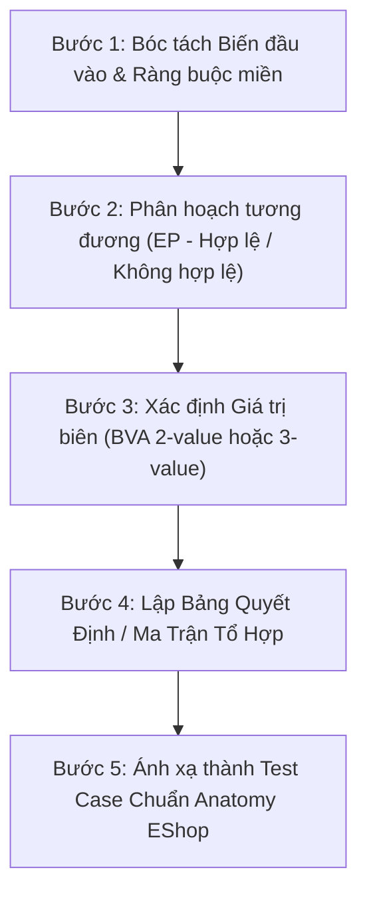

# Phương Pháp Kiểm Thử Miền & Phân Tích Giá Trị Biên Cho EShop (Domain Testing & BVA)

Tài liệu hướng dẫn áp dụng kỹ thuật **Kiểm thử Miền (Domain Testing / Equivalence Partitioning)** và **Phân tích Giá trị Biên (Boundary Value Analysis - BVA)** vào hệ thống EShop theo chuẩn mực kiểm thử chuyên nghiệp (ISTQB Foundation Level & Kaner–Falk–Nguyen).

---

## 1. Quy Trình 5 Bước Thiết Kế Theo Chuẩn Kỹ Thuật

Khi thiết kế test case cho bất kỳ tính năng nào thuộc 4 Pool của EShop, bắt buộc thực hiện tuần tự qua 5 bước sau:

---

## 2. Bóc Tách Biến Miền & Phân Hoạch Tương Đương (Equivalence Partitioning)

Mỗi biến đầu vào phải được phân chia thành các lớp tương đương:
- **Lớp hợp lệ (Valid Equivalence Class - VEC)**: Giá trị được hệ thống chấp nhận và xử lý thành công.
- **Lớp không hợp lệ (Invalid Equivalence Class - IEC)**: Giá trị bị hệ thống từ chối và báo lỗi có kiểm soát.

### Bảng phân hoạch mẫu cho các tính năng trọng yếu của EShop

| Tính năng | Biến đầu vào | Ràng buộc nghiệp vụ | Lớp hợp lệ (VEC) | Lớp không hợp lệ (IEC) |
|---|---|---|---|---|
| **FR-01: Đăng ký** | `password` | Độ dài ≥ 8, có chữ hoa, thường, số, ký tự đặc biệt | `V1`: Độ dài ≥ 8 có đủ 4 loại ký tự | `I1`: Độ dài < 8 `I2`: Thiếu chữ hoa `I3`: Thiếu chữ thường `I4`: Thiếu chữ số `I5`: Thiếu ký tự đặc biệt |
| | `email` | Chuẩn định dạng RFC 5322, chưa tồn tại | `V2`: Email đúng chuẩn và chưa có trong DB | `I6`: Sai định dạng (thiếu `@`, thiếu domain) `I7`: Email đã tồn tại trong CSDL |
| | `confirmPassword` | Khớp 100% với `password` | `V3`: Trùng khớp hoàn toàn với `password` | `I8`: Khác biệt ít nhất 1 ký tự |
| **FR-02: Đăng nhập** | `login_attempts` | Khóa khi ≥ 3 lần sai liên tiếp | `V4`: Sai 1 hoặc 2 lần (cho phép thử tiếp) | `I9`: Sai 3 lần liên tiếp (khóa 30s) `I10`: Đăng nhập khi đang trong 30s khóa |
| **FR-04: Hồ sơ** | `phone` | Bắt đầu bằng `0`, độ dài 10–11 số | `V5`: Bắt đầu bằng 0, độ dài 10 số `V6`: Bắt đầu bằng 0, độ dài 11 số | `I11`: Bắt đầu bằng số khác 0 (vd: `1`, `9`) `I12`: Độ dài ≤ 9 chữ số `I13`: Độ dài ≥ 12 chữ số `I14`: Chứa chữ cái hoặc ký tự đặc biệt |
| **FR-06: Chi tiết SP** | `quantity` | Số nguyên dương, tối thiểu 1 | `V7`: Số nguyên ≥ 1 (vd: 1, 2, 10) | `I15`: Bằng 0 `I16`: Số âm (vd: -1) `I17`: Số thập phân (vd: 1.5) `I18`: Chuỗi ký tự / để trống |
| **FR-11: Lịch sử đơn** | `user_isolation` | Chỉ xem đơn của chính mình | `V8`: Token user A chỉ trả về đơn có `user_id = A` | `I19`: Xem được đơn của user B khi đổi ID / không token |
| | `cancel_action` | Chỉ hủy khi `pending` hoặc `confirmed` | `V9`: Hủy khi đơn ở `pending` `V10`: Hủy khi đơn ở `confirmed` | `I20`: User hủy khi đơn ở `shipping` (phải bị chặn) `I21`: Hủy khi đơn đã `delivered` `I22`: Hủy khi đơn đã `canceled` |
| **FR-15: Sản phẩm (Admin)** | `price` | Bắt buộc, số dương > 0 | `V11`: Số thực dương > 0 (vd: 100.000, 1) | `I23`: Bằng 0 `I24`: Số âm `I25`: Để trống hoặc chữ |
| | `name` | Tối đa 255 ký tự, không rỗng | `V12`: Độ dài từ 1 đến 255 ký tự | `I26`: Rỗng (0 ký tự) `I27`: Độ dài 256 ký tự trở lên |
| | `category_id` | Phải thuộc danh mục có sẵn | `V13`: ID danh mục tồn tại trong CSDL | `I28`: ID không tồn tại / để trống |
| | `edit_isolation` | Chỉ sửa SP đang chọn | `V14`: Sửa SP #1 chỉ đổi tên SP #1 | `I29`: Làm đổi tên các SP khác trong danh sách |
| **Mobile: Lịch sử đơn** | `network_state` | Xử lý mạng online/offline | `V15`: Mạng kết nối bình thường, tải đủ danh sách đơn | `I30`: Mất mạng/timeout (phải báo lỗi mạng + nút Thử lại, không hiển thị nhầm giỏ hàng rỗng) |
| | `order_cancel_ui` | Ẩn nút hủy khi `shipping` | `V16`: Ẩn nút Hủy khi đơn `shipping` trên Mobile | `I31`: Hiển thị nút Hủy khi `shipping` (như lỗi bên Web) |

---

## 3. Phân Tích Giá Trị Biên (Boundary Value Analysis - BVA)

Biên là nơi tập trung hơn 80% lỗi logic lập trình (ví dụ dùng nhầm toán tử `<` thay vì `<=`, `>` thay vì `>=`).

### Hai trường phái BVA:
1. **2-Value BVA**: Xét 2 giá trị trên mỗi ranh giới:
   - **Boundary** (trên biên)
   - **Just Outside Boundary** (ngay ngoài biên, liền kề)
2. **3-Value BVA** (Khuyến khích trong bài tập lớn để đạt điểm tối đa):
   - **Boundary - 1** (ngay dưới biên)
   - **Boundary** (ngay trên biên)
   - **Boundary + 1** (ngay trên biên ngoài)

### Bảng giá trị biên cụ thể cho EShop

| Tính năng / Biến | Ranh giới | Kỹ thuật BVA | Giá trị kiểm thử cụ thể | Kết quả mong đợi |
|---|---|---|---|---|
| **Mật khẩu (`password`)** | Biên dưới: 8 ký tự | 3-value | • 7 ký tự (`Abc1!xy`) • 8 ký tự (`Abc1!xyz`) • 9 ký tự (`Abc1!xyzt`) | • 7 ký tự: Báo lỗi "Tối thiểu 8 ký tự" • 8 ký tự: Hợp lệ, chấp nhận • 9 ký tự: Hợp lệ, chấp nhận |
| **Đăng nhập sai (`attempts`)** | Ngưỡng khóa: 3 lần | 2-value / 3-value | • 2 lần sai • 3 lần sai • 4 lần sai (trong 30s) | • Lần 2: Báo lỗi đăng nhập sai, không khóa • Lần 3: Báo tài khoản tạm khóa 30 giây • Lần 4: Chặn ngay lập tức, báo đang bị khóa |
| **Số điện thoại (`phone`)** | Biên độ dài: [10, 11] | 3-value biên 10 3-value biên 11 | • 9 số (`091234567`) • 10 số (`0912345678`) • 11 số (`01234567890`) • 12 số (`012345678901`) | • 9 số: Báo lỗi số điện thoại không hợp lệ • 10 số: Hợp lệ, cập nhật thành công • 11 số: Hợp lệ, cập nhật thành công • 12 số: Báo lỗi số điện thoại không hợp lệ |
| **Số lượng SP (`quantity`)** | Biên dưới: 1 | 2-value | • 0 • 1 • 2 | • 0: Bị chặn/không cho bấm thêm hoặc báo lỗi • 1: Hợp lệ, thêm 1 sản phẩm vào giỏ • 2: Hợp lệ, thêm 2 sản phẩm vào giỏ |
| **Coupon SAVE10 (`total`)** | Ngưỡng: 300.000 ₫ | 3-value | • 299.999 ₫ (dưới biên) • 300.000 ₫ (trên biên) • 300.001 ₫ (trên biên) | • 299.999 ₫: Báo lỗi chưa đạt ngưỡng tối thiểu • 300.000 ₫: Hợp lệ, giảm 30.000 ₫ (10%) • 300.001 ₫: Hợp lệ, giảm 30.000 ₫ |
| **Coupon EXPIRED (`date`)** | Hạn dùng: 2020-01-01 | 2-value | • 2019-12-31 23:59:59 • 2020-01-01 00:00:00 | • Trước hạn: Hợp lệ • Bằng/sau hạn: Báo mã đã hết hạn |
| **Lượt dùng coupon (`uses`)** | Giới hạn: `max_uses = 1` | 3-value | • Đã dùng 0 lần • Đã dùng 1 lần • Thử dùng lần 2 | • Lần 1 (used=0): Áp dụng thành công • Lần 2 (used=1): Báo đã dùng hết lượt cho phép |
| **Giá sản phẩm (`price`)** | Biên dưới: > 0 | 2-value | • 0 ₫ • 1 ₫ | • 0 ₫: Bị từ chối, báo giá phải là số dương • 1 ₫: Hợp lệ, tạo sản phẩm thành công |
| **Tên sản phẩm (`name`)** | Biên trên: 255 ký tự | 3-value | • 254 ký tự • 255 ký tự • 256 ký tự | • 254 & 255 ký tự: Hợp lệ, lưu đủ tên • 256 ký tự: Báo lỗi vượt quá 255 ký tự |

---

## 4. Bảng Quyết Định Cho Quy Tắc Đa Điều Kiện (Decision Table Testing)

Khi một tính năng phụ thuộc đồng thời vào nhiều điều kiện logic, sử dụng **Bảng Quyết Định (Decision Table)** để bao phủ toàn diện mà không bỏ sót tổ hợp lỗi.

### Ví dụ: FR-09 Áp dụng Mã Giảm Giá (5 Điều Kiện C1..C5)

- **C1**: Mã tồn tại và `is_active = 1`
- **C2**: Còn hạn sử dụng (`now < expired_at`)
- **C3**: Tổng tiền đơn hàng đạt ngưỡng (`total >= min_order_amount`)
- **C4**: Đã đăng nhập (`token` hợp lệ)
- **C5**: Số lần đã dùng chưa vượt quá giới hạn (`uses < max_uses`)

| Quy tắc (Rule) | C1 (Tồn tại) | C2 (Còn hạn) | C3 (Đủ ngưỡng) | C4 (Đã login) | C5 (Còn lượt) | Hành động / Kết quả mong đợi |
|---|:---:|:---:|:---:|:---:|:---:|---|
| **R01 (Happy Path)** | **T** | **T** | **T** | **T** | **T** | Áp dụng giảm giá thành công, tính lại tổng tiền |
| **R02 (Không tồn tại)**| **F** | - | - | - | - | Báo lỗi: "Mã giảm giá không tồn tại" |
| **R03 (Hết hạn)** | **T** | **F** | - | - | - | Báo lỗi: "Mã giảm giá đã hết hạn sử dụng" |
| **R04 (Chưa đủ tiền)**| **T** | **T** | **F** | - | - | Báo lỗi: "Đơn hàng chưa đạt giá trị tối thiểu" |
| **R05 (Chưa login)** | **T** | **T** | **T** | **F** | - | Báo lỗi: "Vui lòng đăng nhập để dùng mã" |
| **R06 (Hết lượt)** | **T** | **T** | **T** | **T** | **F** | Báo lỗi: "Bạn đã sử dụng hết lượt cho mã này" |

*Ghi chú:* Ma trận trên giúp giảm từ $2^5 = 32$ test case xuống còn 6 test case trọng yếu mang lại hiệu quả bắt lỗi cao nhất.

---

## 5. Kiểm Thử Chuyển Đổi Trạng Thái (State Transition Testing — FR-10)

Đơn hàng EShop có 5 trạng thái: `pending`, `confirmed`, `shipping`, `delivered`, `canceled`.

### Ma trận chuyển đổi trạng thái:

| Từ trạng thái | Đến `pending` | Đến `confirmed` | Đến `shipping` | Đến `delivered` | Đến `canceled` |
|---|:---:|:---:|:---:|:---:|:---:|
| `pending` | Không đổi | **Hợp lệ (Admin)** | Không hợp lệ (400) | Không hợp lệ (400) | **Hợp lệ (User/Admin)** |
| `confirmed` | Không hợp lệ (400)| Không đổi | **Hợp lệ (Admin)** | Không hợp lệ (400) | **Hợp lệ (User/Admin)** |
| `shipping` | Không hợp lệ (400)| Không hợp lệ (400)| Không đổi | **Hợp lệ (Admin)** | **Chỉ Admin (User bị 403)** |
| `delivered` | Không hợp lệ (400)| Không hợp lệ (400)| Không hợp lệ (400)| Không đổi | Không hợp lệ (Final State) |
| `canceled` | Không hợp lệ (400)| Không hợp lệ (400)| Không hợp lệ (400)| Không hợp lệ (400)| Không đổi (Final State) |

---

## 6. Bộ Heuristic Kiểm Thử Di Động (Pool D — Mobile App)

Khi kiểm thử trên ứng dụng React Native của EShop, bổ sung các test case bao phủ 5 khía cạnh di động:
1. **Network Throttling & Timeout**: Giả lập mạng 2G/3G hoặc ngắt kết nối đột ngột khi đang gửi request thanh toán -> Hệ thống phải có cơ chế retry an toàn, không tạo 2 đơn hàng trùng.
2. **System Interruptions**: Nhận cuộc gọi đến (Incoming Call) hoặc bật chế độ chia đôi màn hình khi đang ở màn hình điền OTP / Thanh toán -> Ứng dụng khôi phục nguyên vẹn trạng thái form khi quay lại.
3. **Soft Keyboard Obstruction**: Mở bàn phím ảo trên màn hình nhỏ -> Kiểm tra nút bấm "Đăng nhập" hoặc "Thanh toán" có bị bàn phím che khuất hay giao diện tự cuộn lên (KeyboardAvoidingView).
4. **App Lifecycle (Background/Foreground)**: Đưa app xuống background 10 phút rồi mở lại -> Kiểm tra phiên đăng nhập và giỏ hàng có giữ nguyên không.
5. **Screen Density & Safe Area**: Giao diện không bị che khuất bởi tai thỏ (Notch), Dynamic Island, hoặc thanh điều hướng cử chỉ ở đáy màn hình.
